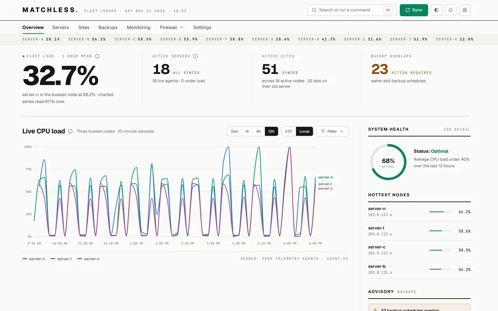
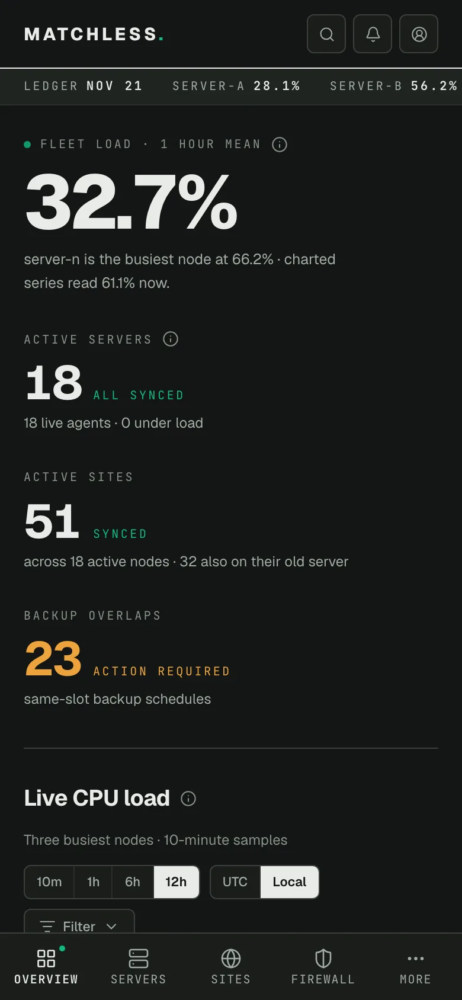
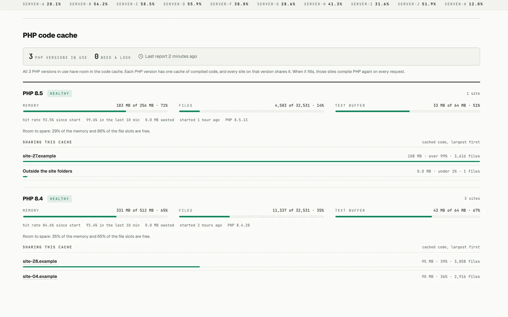

# Fleet

A private dashboard for the GridPane servers and WordPress sites one team runs. It puts servers, sites, backup
schedules, live load, server firewalls, Fail2Ban behind Cloudflare and each zone's Cloudflare WAF rules in one place.

You host it yourself. The app runs on Cloudflare Workers, the data lives in your own Supabase project, and it sits
behind Cloudflare Access with its own sign-in behind that. The name, wordmark, hostname and browser theme color come
from `fleet.config.ts`; the palette is in `app/globals.css`.

**To set it up, follow [SETUP.md](SETUP.md).** It is a numbered runbook that a person or a coding agent can follow step
by step. Every step ends with a check.

## Screenshots

From the author's own install, with every server, site and address replaced. Your copy shows its own name and
wordmark, from `fleet.config.ts`.







More of every page, on desktop and phone, in the tour article below.

## Articles

How each part works and why, written while building it:

- [A tour of the whole app](https://jonphillips.dev/posts/matchless-fleet-gridpane-dashboard), with screenshots
- [One firewall standard for every site: 7G, 8G and Cloudflare](https://jonphillips.dev/posts/gridpane-firewall-fleet-7g-8g-cloudflare)
- [Trying 8G beside 7G, in watch mode](https://jonphillips.dev/posts/8g-firewall-watch-mode-gridpane)
- [A 7G exception generator](https://jonphillips.dev/posts/7g-firewall-exception-generator)
- [Fail2Ban that bans the attacker, not Cloudflare](https://jonphillips.dev/posts/fail2ban-cloudflare-gridpane), with a scoped Cloudflare token
- [OPcache: every site on a PHP version shares one](https://jonphillips.dev/posts/gridpane-opcache)

## What it is not

**Fleet is not a replacement for GridPane, and it is not meant to be one.** It covers part of what GridPane's own
dashboard does, through GridPane's public API, and that API is rate limited: about 12 requests a minute on each
route. A sync reads one site about every 11 seconds (about 18 minutes for 100 sites), and a bulk PHP change waits
35 seconds between sites. For many everyday tasks, GridPane's own dashboard is still the faster place to work.

Where Fleet earns its place is on a phone, and in what GridPane's dashboard does not show: live load, memory and
disk from its own agent on each server, how full each PHP version's code cache is, 7G and 8G block counts, Fail2Ban's
jails and bans, each Cloudflare zone's WAF rules, and backup schedules that start in the same slot.

What it does not do:

- **It is not affiliated with, endorsed by or supported by GridPane.** It uses GridPane's public API with your own
  account's token.
- **It does not create, move or delete servers or sites.** It writes to GridPane in three places only: a site's PHP
  settings, its caching (page cache, time to live, Redis object cache, cache clearing) and its backup schedule times.
- **It cannot show GridPane's logs.** GridPane's API does not serve a site's or a server's log files (nginx, PHP, the
  slow log), so there is no log viewer. What Fleet knows of 7G, 8G and Fail2Ban comes from its own agent on each
  server, as counts and summaries.
- **It cannot see what the API does not expose:** backup runs (only their schedules), staging sites (kept by hand in
  the app, and labeled so), or Object Cache Pro and Relay settings beyond whether Object Cache Pro is on.
- **It cannot change a site's PHP slow log.** GridPane's API refuses those settings.
- **It cannot sync only part of an account.** Every server and site your GridPane token can see comes over on each
  sync. (Choosing which servers and sites to bring in is planned.)
- **It is not real time.** What comes from GridPane is as fresh as the last sync, and the agents report every
  10 minutes.
- **It is not a backup tool.** It shows backup schedules; it does not take or restore a backup.
- **It does not run commands on your servers for you.** The root tools are scripts you run yourself over SSH. The one
  thing the app can start on a server is a one-time WordPress sign-in link.
- **It is not built for several teams.** Every account you make sees every server. (One-click WordPress sign-in has
  its own allow-list.)
- **It is not a hosted service.** Nobody runs it for you.

## Try it on a spare server first

A sync only reads from GridPane: it never changes a server or a site. Everything that does touch a server (the
telemetry agent, the firewall and Fail2Ban tools, one-click sign-in) acts only on a server you name, and SETUP.md
proves each one on a single server before the rest. So a good first run is:

1. Make a small server in GridPane that you can delete afterward.
2. Clone one development site onto it: not a live store, and not a client's live site.
3. Follow SETUP.md to the first sync. In step 7, list only the spare server: the scripts that connect over SSH read
   that list. Then do step 8 and any optional features on that server alone. The one-click sign-in installer is the
   exception: it reads servers from the database, so its look-only audit (run with no option) connects to every
   synced server, read-only. To keep to the spare server, run only `--apply` with its label.
4. When you are done, delete the server in GridPane.

## What it does, and what each part needs

Everything needs the first two rows. The rest is optional: leave a row out and its pages stay empty.

| Part | What you get | What it needs |
| --- | --- | --- |
| Servers, sites, backup schedules | Every server and site in your GridPane account, searchable; PHP settings, caching and backup times you can change | A GridPane API token; a Supabase project |
| The app itself | The dashboard at your own hostname, behind your own sign-in | Cloudflare Workers and Cloudflare Access; a hostname on a zone of yours |
| Monitoring and server firewall pages | Load, memory and disk every 10 minutes; hardware; web ports; Fail2Ban, 7G WAF and PHP code cache status per server | The telemetry agent on each server, installed once over root SSH. It opens no port and calls only outward; to read PHP's code cache it keeps one small read-only PHP file outside the web roots and runs it through each PHP version's own PHP-FPM socket (SETUP.md, step 8) |
| Cloudflare WAF board | The custom rules of every zone, compared with a standard you write | A read-only Cloudflare API token kept on your own machine, and a daily job there. The app never holds it |
| Fail2Ban behind Cloudflare | Per-site jails that ban at Cloudflare, in that site's own zone | Root SSH; one Cloudflare token per server; the WAF board's inventory |
| One-click WordPress sign-in | A button that signs you in to a site's WordPress. Off until you turn it on | One more SQL file, two keys, a small service on each server, Cloudflare Access |
| Root tools | Lock web ports to Cloudflare, log rotation, an operator allowlist, server snapshots, two-pass site moves | Root SSH from your own machine |

The browser reads only your Supabase project. Four things fill it:

- **GridPane's API**, through the masthead Sync button, the first-sync button under Settings, Setup, or `npm run sync`
  (`scripts/sync-gridpane.ts`). One sync runs at a time; every screen shows one running, and `npm run sync:status`
  follows it from a terminal.
- **The telemetry agent** on each server (`scripts/telemetry-agent.sh`: cron every 10 minutes, outbound calls only,
  one token per server; it also runs a small read-only PHP file through each PHP version's local PHP-FPM socket to
  read the code cache).
- **The daily Cloudflare WAF job** on your own machine (`npm run waf:refresh`).
- **Records kept by hand** where no API exists (staging sites, IP ledgers), labeled as such in the app.

## The root tools run as root, on your servers, at your own risk

The scripts in `scripts/` that connect to a server do so as root over SSH. They are yours to run and yours to answer
for: nobody has tested them on your servers.

Run with no option, almost every one audits or does a dry run: it reads, says what it found and changes nothing. A
change needs an option you type (`--apply`, `--live`, `--update` and the like), and most take one server's name so
you can prove a change on one before the rest. `scripts/install-waf-refresh.sh` with no option says what `--apply`
would install on this machine and installs nothing. `scripts/install-operator-allowlist.sh` without
`--apply` reads each server, says what the same command with `--apply` would do there and changes nothing: that
holds for an address, for `--clear` and for the two web-port options. Each script's header says what it
changes, how to look first and how to undo it. Read the header before you run one.

Two say in their headers that they are not read-only in any mode: `scripts/fleet-site-final-copy.sh` replaces the
database of a site's copy on the new server, and `scripts/fleet-fail2ban-token-proof.sh` makes one Cloudflare rule and
removes it again.

## Security model

1. **Cloudflare Access is in front.** Nobody reaches the app without passing your Access policy, and the Worker's
   default `*.workers.dev` address is switched off so there is no way around it. With the two Access settings set,
   the app also checks every request's Access token itself and refuses one without it.
2. **The app's own sign-in is behind it.** Accounts are made by you, and sign-ups are off.
3. **A session opened with a password alone never enters.** A session must have had a code from an authenticator
   app, or been opened with a passkey, before it gets past the login page. Every account must have an authenticator
   app: until a new account sets one up, its password is all it has ([SECURITY.md](SECURITY.md)).
4. **The database holds the same rule.** Every table answers only a session that passed a second factor, for an
   account that has an authenticator app, so going straight to the database's own API does not get around the app.
5. **The public (anon) key opens no table.** A signed-out caller holds no privilege on any table. The server agents
   use that key only to call their report functions, and each call must carry that server's own token.

[SECURITY.md](SECURITY.md) has the rest: what to know before you deploy, and how to report a weakness in private.

## How you know it works

- **`npm run doctor`** looks at your own install and says, one line per check, what is set up, what is missing and
  what is broken. It changes nothing and prints no secret. Run it after every setup step.
- **The test suites.** Every script in `package.json` whose name ends in `:test` is a suite that needs no real
  service, covering the sign-in rules, the database migrations (on an in-memory Postgres), the server
  scripts (against made-up servers), the Cloudflare and GridPane readers (against stand-ins), the privacy gate, the
  export and the doctor itself. Each prints how many checks it ran. Most also run controls: copies broken on
  purpose, which the suite must catch. Two more are run by name: `npm run sso:e2e` and
  `bash scripts/test-set-email-change-template.sh`.
- **CI.** On every push to `main` and every pull request, GitHub runs the type check, all of those suites (in four
  parts side by side, split by `scripts/ci-shard.mjs`), the privacy gate and a production build
  (`.github/workflows/ci.yml`), and lint. The suites were proven on macOS, so that is where they run. A Linux run is
  started by hand from the Actions tab (`.github/workflows/linux.yml`) until it has been seen to pass there.

None of that touches your servers. The tests prove the scripts against stand-ins, not against your fleet.

## Stack

Next.js 16 (App Router), React 19, Tailwind 4, Supabase (Postgres, Auth, Realtime, pg_cron), deployed to Cloudflare
Workers with `@opennextjs/cloudflare`.

The database is built by the files in `supabase/migrations/`, applied in name order (SETUP.md, step 4). `sso_schema.sql`
at the root is not in the baseline: it is applied only if you turn on one-click WordPress sign-in (SETUP.md, step
11c). Any other `.sql` file at the root is an earlier step the baseline already holds: do not run it.

## Commands

```bash
npm run doctor                    # what is set up, what is missing, what is broken
npm run dev                       # the app on this machine (reads .env.local)
npm run user:create -- <email>    # make an account; it asks for the password
npm run sync                      # GridPane -> your database
npm run sync:status -- --watch    # follow a running sync, wherever it started
npm run waf:refresh               # Cloudflare WAF inventory -> your database
npm run deploy                    # build, take your keys out of the bundle, deploy the Worker
npm run lint
```

## Read before changing anything

- `SETUP.md`: the runbook.
- `SECURITY.md`: how to report a weakness, and what to know before you deploy this.
- `AGENTS.md` (which `CLAUDE.md` points at): where an agent starts. It points at `SETUP.md` and its rules.
- `docs/gridpane-api-v1-findings.md`: what GridPane's API does and does not do, and its write quirks.
- `docs/cloudflare-waf-standard.md`: the words the Cloudflare WAF board uses, and how to write your standard.
- `docs/sign-in-email.md`: changing a sign-in email, and the Supabase settings it leans on.
- `docs/parked-features.md`: features removed because no API backs them, and how to bring each back.
- `docs/DESIGN.md`: the design system.

## License

MIT. See [LICENSE](LICENSE).
